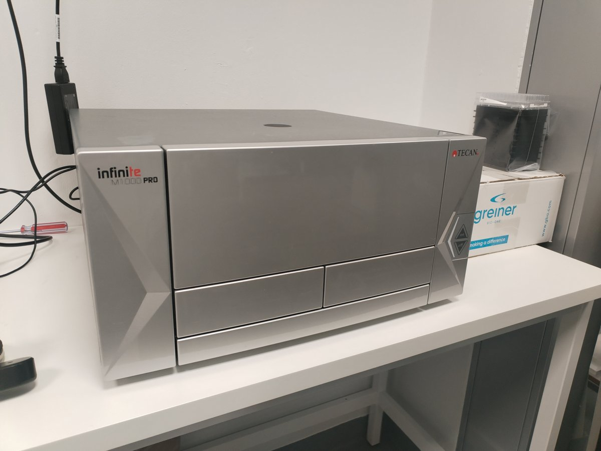

# Tecan Infinite M1000 Pro



The Tecan Infinite M1000 Pro is a monochromator-based multimode plate reader. This
PyLabRobot backend talks to it directly over USB, without Tecan's i-control software. It
was built to send the same commands as i-control 2.0 and to return the same numbers.

```{note}
This backend is experimental. It was developed against one reader (absorbance and top
fluorescence fitted) and checked on an empty plate carrier. It has not yet been compared
with i-control on plates with real samples.
```

## Where the code is

| What | Where |
| --- | --- |
| Backend | `pylabrobot/tecan/infinite_m1000_pro.py` (class `InfiniteM1000Pro`, imported as `from pylabrobot.tecan import InfiniteM1000Pro`) |
| Tests | `pylabrobot/tecan/infinite_m1000_pro_*tests.py` |
| Hello world | [hello-world notebook](hello-world) in this folder |
| Version described here | commit `f21faf3a2a33088979d709b50008087ab7c311e6` on branch `tecan-plate-reader` ([PyLabRobot PR #1684](https://github.com/PyLabRobot/pylabrobot/pull/1684)) |

The commit hash refers to the branch in the pull request. If the pull request is
squash-merged, PyLabRobot's main branch will contain the same code under a different hash.

## Before you start

- Install PyLabRobot with USB support: `pip install -e ".[usb]"`.
- On Windows, the reader needs the **libusbK** driver for PyLabRobot (install it once with
  Zadig). i-control needs Tecan's own driver, so only one of them can use the reader at a
  time. Switch back to Tecan's driver to use i-control again.
- Close i-control before connecting from PyLabRobot.
- The backend reads i-control's plate definitions (`.pdfx` files in
  `C:\Users\Public\Documents\Tecan\Pdfx`) when they are installed. Without them, only
  the built-in `GRE96ft` and `GRE384ft` definitions are available. You can also pass a
  `PlateGeometry` yourself.
- Software safety limits were removed on purpose; the reader's firmware decides what it
  accepts. Keep the carrier path clear and supervise runs.

## Using it: the hello-world notebook

The [hello-world notebook](hello-world) walks through a full session. In short:

```python
from pylabrobot.resources.biorad.plates import biorad_96_wellplate_200uL_Vb
from pylabrobot.tecan import InfiniteM1000Pro

reader = InfiniteM1000Pro()
await reader.setup()            # connect and run i-control's startup sequence

plate = biorad_96_wellplate_200uL_Vb("plate")   # gives the well names
await reader.open()             # move the carrier out, place the plate
await reader.close()

od = await reader.read_absorbance(plate, None, 600, plate_definition="GRE96ft")
print(od.data["A1"])

fl = await reader.read_fluorescence(
  plate, plate.get_items("A1:B3"), 485, 535,
  plate_definition="GRE96ft", gain="optimal",
)
print(fl.data["A1"], fl.gain)

await reader.stop()
```

`plate_definition` names the i-control plate type, which sets the well positions and the
read height. The PyLabRobot plate is used for well names only.

## What it can do

| Area | Supported |
| --- | --- |
| Instrument | setup (i-control's startup sequence), status, carrier open/close, temperature read/set/off, shaking (linear, orbital, double; i-control's amplitudes) |
| Absorbance | single wavelength; reference wavelength (returns the difference and both ODs); spectrum; plate lid; settle time; flashes; Z height calculated as i-control does, or set by hand |
| Absorbance, multiple reads per well | filled square, square, x-line, y-line and xy-lines patterns, any size and border; per-read values and standard deviation |
| Fluorescence (top) | excitation/emission wavelength and bandwidth, gain, flashes, 400 Hz / 100 Hz / On-the-Fly flash modes, integration and lag time, settle time, Z |
| Fluorescence, automatic settings | optimal gain from the whole plate or from one well, with a target percentage; optimal Z calculated from one well |
| Fluorescence, multiple reads per well | same patterns as absorbance |
| Fluorescence spectra | excitation and emission scans, corrected with the reader's own correction tables as i-control does |
| Stop | a cancelled or failed measurement stops the reader the way i-control's Stop button does and leaves it ready for the next run |

## How it was verified

- USB traffic of i-control running each of these features was captured. Replaying each
  capture through the backend gives exactly i-control's commands, and the results match the
  values i-control wrote to Excel (to i-control's rounding).
- i-control's own calculations (read height, multiple-read spacing, scan correction, gain)
  were taken from i-control itself, not estimated.
- Every feature was run on the reader. On an empty carrier, optimal gain matched
  i-control (228 vs 228/229).

## What is not implemented yet

| Missing | Why / status |
| --- | --- |
| Luminescence, fluorescence polarization, injectors, bottom fluorescence | not fitted on the development reader; the firmware rejects them there |
| Circle and filled-circle multiple-read patterns | i-control uses built-in point tables that were not extracted |
| Extended dynamic range (automatic dual gain) | not captured yet |
| Multiple reads together with reference wavelength or On-the-Fly flashes; fluorescence spectra with optimal gain | not captured yet |
| Reference wavelength across several plate rows | runs, but the move order is inferred from a single-well capture |
| Optimal Z on low or flat signals | the search can pick a different height than i-control when the signal barely changes with height (seen on an empty carrier) |
| Validation on real samples | not yet compared with i-control on plates with samples |
| Optimal gain and optimal Z in the same read | runs, but this combination was not captured from i-control |
| Kinetic loops, i-control "parts" and other method-level features | not part of the instrument backend; use Python loops and timing instead |
